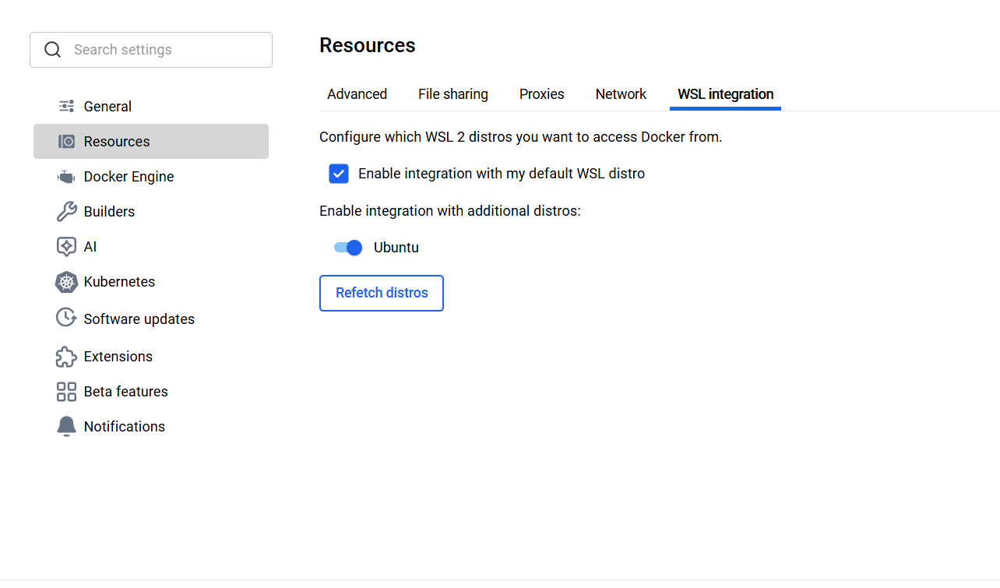

# 2. Configuración en Windows (WSL2 + Git Bash)

## Errores comunes en Windows

### Error: "The system cannot find the path specified"

**Problema:** Al ejecutar `php artisan sail:install` en Windows, aparece el error `The system cannot find the path specified`.

**Causa:** Laravel Sail requiere WSL2 (Windows Subsystem for Linux) para funcionar correctamente en Windows, ya que Docker necesita un entorno Linux.

**Solución:**

#### Paso 1: Instalar WSL2 con Ubuntu

1. Abre **PowerShell como administrador** (clic derecho → "Ejecutar como administrador")

2. Ejecuta el siguiente comando:

   ```powershell
   wsl --install -d Ubuntu
   ```

3. **Reinicia tu ordenador** (es necesario para que WSL2 se active)

4. Después del reinicio, abre la aplicación **Ubuntu** desde el menú inicio de **Windows**
   - La primera vez te pedirá crear un usuario y contraseña de Linux
   - Completa la configuración inicial

#### Paso 2: Instalar y configurar Docker Desktop

1. Descarga e instala [Docker Desktop para Windows](https://www.docker.com/products/docker-desktop/)

2. Abre Docker Desktop y ve a **Settings** (⚙️)

3. En la sección **General**, asegúrate de que la opción **"Use the WSL 2 based engine"** esté activada

   

4. En la sección **Resources → WSL Integration**:

   - Activa **"Enable integration with my default WSL distro"**
   - Activa **Ubuntu** en la lista de distribuciones
     

5. Aplica los cambios y reinicia Docker Desktop

#### Paso 3: Ejecutar Sail

Tienes dos opciones para trabajar con Laravel Sail en Windows:

##### Opción A: Desde la terminal de Ubuntu (WSL2)

1. Abre la aplicación **Ubuntu** desde el menú inicio de Windows

2. Navega a tu proyecto Laravel (los archivos dentro de la C: de Windows están en `/mnt/c/`):

   ```bash
   cd /mnt/c/Users/TuUsuario/ruta/a/tu/proyecto
   ```

   Por ejemplo:

   ```bash
   cd /mnt/c/Users/Juan/Documents/mi-proyecto-laravel
   ```

3. Ejecuta Sail:

   ```bash
   ./vendor/bin/sail up -d
   ```

4. Verifica que los contenedores están corriendo:

   ```bash
   ./vendor/bin/sail ps
   ```

> **Ventajas de esta opción:**
>
> - Mejor rendimiento y compatibilidad con Docker
> - Experiencia más cercana al entorno de producción
> - Recomendado si vas a trabajar frecuentemente con Laravel

##### Opción B: Desde Git Bash en Windows

1. Abre **Git Bash** en la carpeta de tu proyecto (clic derecho → "Git Bash Here")

2. Asegúrate de que **Docker Desktop esté corriendo** (icono de Docker en la bandeja del sistema)

3. Ejecuta Sail:

   ```bash
   vendor/bin/sail up -d
   ```

   > **Nota:** En Git Bash **no** uses `./` al inicio del comando. Usa `vendor/bin/sail` directamente.

   Si tienes problemas, prueba con:

   ```bash
   bash vendor/bin/sail up -d
   ```

4. Verifica que los contenedores están corriendo:

   ```bash
   vendor/bin/sail ps
   ```

> **Ventajas de esta opción:**
>
> - Más cómodo si prefieres trabajar en el entorno Windows
> - No necesitas cambiar de terminal constantemente
> - Funciona bien para proyectos pequeños

#### Verificar que todo funciona

Independientemente de la opción que elijas, una vez que los contenedores estén corriendo:

```bash
# Acceder a la aplicación
# Abre tu navegador en: http://localhost
```

Deberías ver la página de bienvenida de Laravel.

#### Recomendaciones según la opción elegida

**Si usas Ubuntu (Opción A):**

- Crea un alias en tu `~/.bashrc` de Ubuntu:

  ```bash
  alias sail='./vendor/bin/sail'
  ```

- Usa VS Code con la extensión **WSL** para editar archivos directamente desde Ubuntu

**Si usas Git Bash (Opción B):**

- Crea un alias en tu `~/.bashrc` de Windows:

  ```bash
  alias sail='bash vendor/bin/sail'
  ```

- Puedes trabajar con VS Code normalmente abriendo la carpeta del proyecto desde Windows

Después de crear el alias, reinicia la terminal y podrás usar simplemente:

```bash
sail up -d
sail ps
sail down
```

### Error: "Docker is not running"

**Problema:** Al intentar ejecutar `vendor/bin/sail up`, aparece el error `Docker is not running` o `Cannot connect to the Docker daemon`.

**Causa:** Docker Desktop no está iniciado o no está configurado correctamente para trabajar con WSL2.

**Solución:**

1. **Inicia Docker Desktop** manualmente desde el menú inicio de Windows

   - Espera a que el icono de Docker en la bandeja del sistema deje de parpadear
   - Debería mostrar "Docker Desktop is running"

2. Si Docker Desktop está corriendo pero sigue el error, verifica la configuración:

   - Abre Docker Desktop y ve a **Settings** (⚙️)
   - En la sección **General**, asegúrate de que **"Use the WSL 2 based engine"** esté activada:

     

   - En la sección **Resources → WSL Integration**:

     - Activa **"Enable integration with my default WSL distro"**
     - Activa **Ubuntu** en la lista de distribuciones disponibles

     

   - Aplica los cambios y reinicia Docker Desktop

3. Vuelve a intentar ejecutar Sail desde Git Bash:

   ```bash
   vendor/bin/sail up -d
   ```

> **Consejo:** Configura Docker Desktop para que se inicie automáticamente con Windows:
> Settings → General → "Start Docker Desktop when you log in"

## Resumen de comandos para Windows

```bash
# Instalar WSL2
wsl --install -d Ubuntu

# Ejecutar Sail desde Git Bash
vendor/bin/sail up -d

# Ver estado
vendor/bin/sail ps

# Detener
vendor/bin/sail down
```

---

**Siguiente paso:** [Añadir phpMyAdmin →](./03-phpmyadmin.md)

**Paso anterior:** [← Instalación](./01-installation.md)

**Volver al índice:** [README](./README.md)
